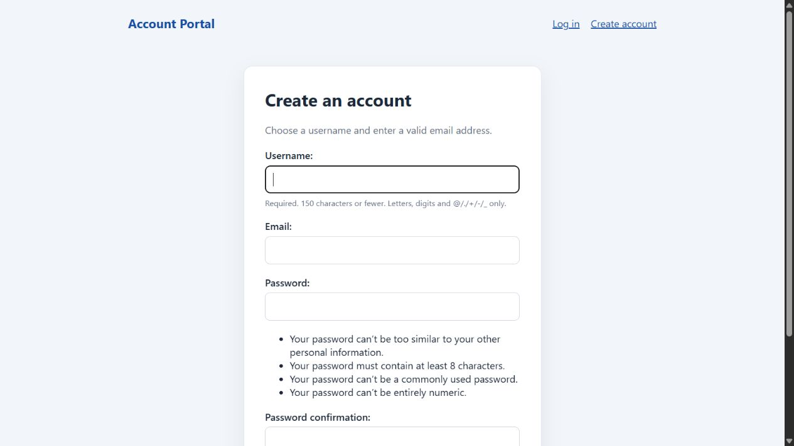

# Django Login and Regex Validation Application

This application provides account registration, login, logout, and a protected dashboard. Django handles authentication and password hashing. The registration form checks usernames and email addresses with regular expressions.

## Setup

Create and activate a virtual environment, then install dependencies:

```bash
python -m venv .venv
.venv\Scripts\activate
python -m pip install -r requirements.txt
```

Initialize the local SQLite database and start the development server:

```bash
python manage.py migrate
python manage.py runserver
```

Open `http://127.0.0.1:8000/`. Create an account at `/signup/`, sign in at `/login/`, and use the protected dashboard. The included settings are for local development.

## Screenshots

The screenshots below show the sign-in and account registration pages. The registration form includes Django's username and password validation guidance.

### Sign in


### Create an account


