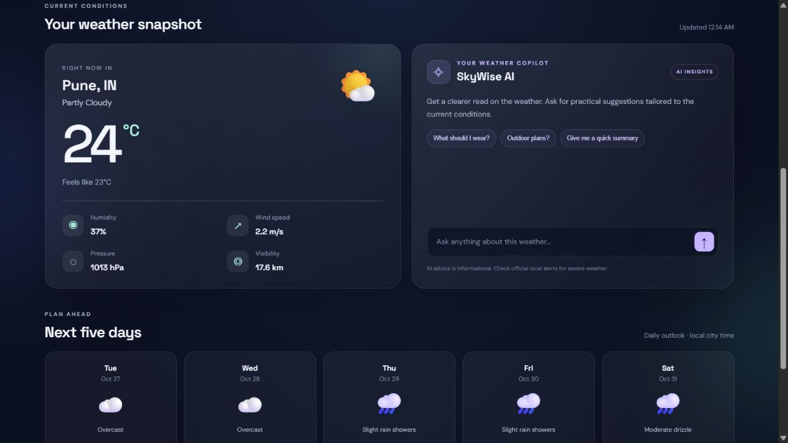

# SkyWise — AI-Powered Weather Dashboard

SkyWise is a responsive Flask weather dashboard. It uses Open-Meteo for current weather and forecasts, so **no weather API key is required**. Its AI weather-advice panel uses Ollama and a local model by default, so it needs no AI API key or paid API credits.

## Features
- City search and quick-search buttons
- Current temperature, feels-like temperature, condition, humidity, wind, pressure and visibility
- Five-day outlook with high/low temperatures and precipitation probability
- Shared current-weather and forecast requests with a short server-side cache to reduce upstream API calls
- Ollama-powered weather Q&A, with local Ollama for development and Ollama Cloud for deployment
- Responsive dark dashboard

## Screenshot

This capture shows a live Pune weather snapshot and five-day forecast. Weather values update when you run the app.


## Requirements
- Python 3.10+
- Internet connection

## Setup in Windows / VS Code
1. Open this project folder in VS Code.
2. Open **Terminal → New Terminal**.
3. Create a virtual environment:
   ```powershell
   python -m venv .venv
   ```
4. Install dependencies:
   ```powershell
   .venv\Scripts\python.exe -m pip install -r requirements.txt
   ```
5. Install [Ollama for Windows](https://ollama.com/download), then download the default model:
   ```powershell
   & "$env:LOCALAPPDATA\Programs\Ollama\ollama.exe" pull llama3.2
   ```
   Ollama runs its local API at `http://127.0.0.1:11434`. Confirm the model is installed with:
   ```powershell
   & "$env:LOCALAPPDATA\Programs\Ollama\ollama.exe" list
   ```
6. Copy `.env.example` to `.env`. The default `AI_PROVIDER=ollama` setting uses the local model and requires no API key. To use Gemini instead, set `AI_PROVIDER=gemini` and add `GEMINI_API_KEY` to `.env`; to use OpenAI, set `AI_PROVIDER=openai` and add its key.
7. Run the application:
   ```powershell
   .venv\Scripts\python.exe app.py
   ```
8. Open http://127.0.0.1:5001 in your browser.

The app defaults to port `5001` so its terminal URL matches the browser address. To use a different port, set `PORT` in `.env` before starting the app.

If PowerShell virtual-environment activation is blocked, the direct `.venv\Scripts\python.exe` commands above avoid activation.

## API routes
- `GET /` — dashboard
- `GET /health` — deployment health check
- `GET /api/weather?city=Pune` — current conditions
- `GET /api/forecast?city=Pune` — five-day forecast
- `POST /api/ai-advice` — AI answer using the configured provider

## Deploy to Render
1. Push this project to a GitHub repository. `.env` and `.venv` are excluded by `.gitignore`; never commit API keys.
2. Create an Ollama Cloud API key in [Ollama key settings](https://ollama.com/settings/keys). Check Ollama's current plan and usage limits before using its cloud API.
3. In Render, choose **New → Blueprint**, connect the GitHub repository, and deploy the included `render.yaml`.
4. When prompted, enter the key as `OLLAMA_API_KEY`. If it is not prompted, add it under the service's **Environment** settings. Keep the Blueprint's `AI_PROVIDER=ollama`, `OLLAMA_BASE_URL=https://ollama.com`, and `OLLAMA_MODEL=gemma4:31b` settings.
5. Wait for the Render health check to pass, then open the public `onrender.com` URL. Test city search, the forecast, and AI advice there.

The Render service uses a production WSGI server and Ollama Cloud for public AI requests. The local `llama3.2` model stays on your computer for local development; Render cannot access your PC's `127.0.0.1` Ollama server. Keep the Ollama API key private and enter it only in Render's secret environment setting. Render's free web services may sleep while idle and can take a little longer on the first request.

## Weather source
Weather and forecast data are retrieved from [Open-Meteo](https://open-meteo.com/). City names are resolved through the Open-Meteo geocoding API. If Open-Meteo rate-limits a forecast request, SkyWise falls back to the global [MET Norway Locationforecast API](https://api.met.no/weatherapi/locationforecast/2.0/documentation). Current weather and forecast are fetched together and cached on the server for ten minutes, reducing duplicate requests and easing upstream rate limits. Forecasts are model-based and may differ from exact local conditions; check official local alerts for safety-critical decisions.

## Notes
- Weather search works without any API key.
- Local Ollama AI runs on your computer and does not use OpenAI API credits. The model needs to be downloaded and Ollama must be running.
- Public deployments use Ollama Cloud; they do not use the Ollama model running on your computer.
- Ollama Cloud requires an Ollama account/API key; its current plan and usage limits may apply.
- OpenAI is available as an optional provider. It requires an API key and available API billing credits; ChatGPT subscriptions and OpenAI API billing are separate.
- Do not commit `.env` or publish API keys.
